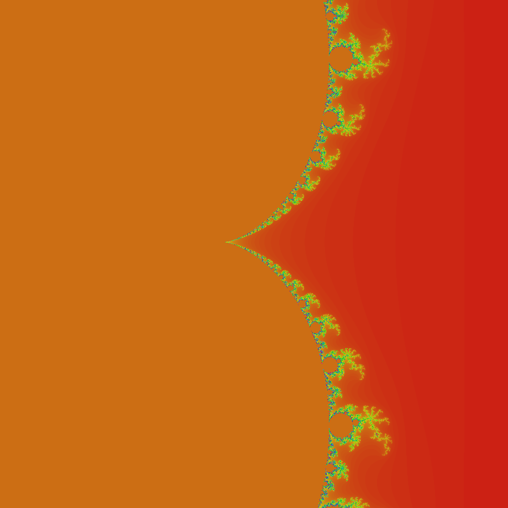
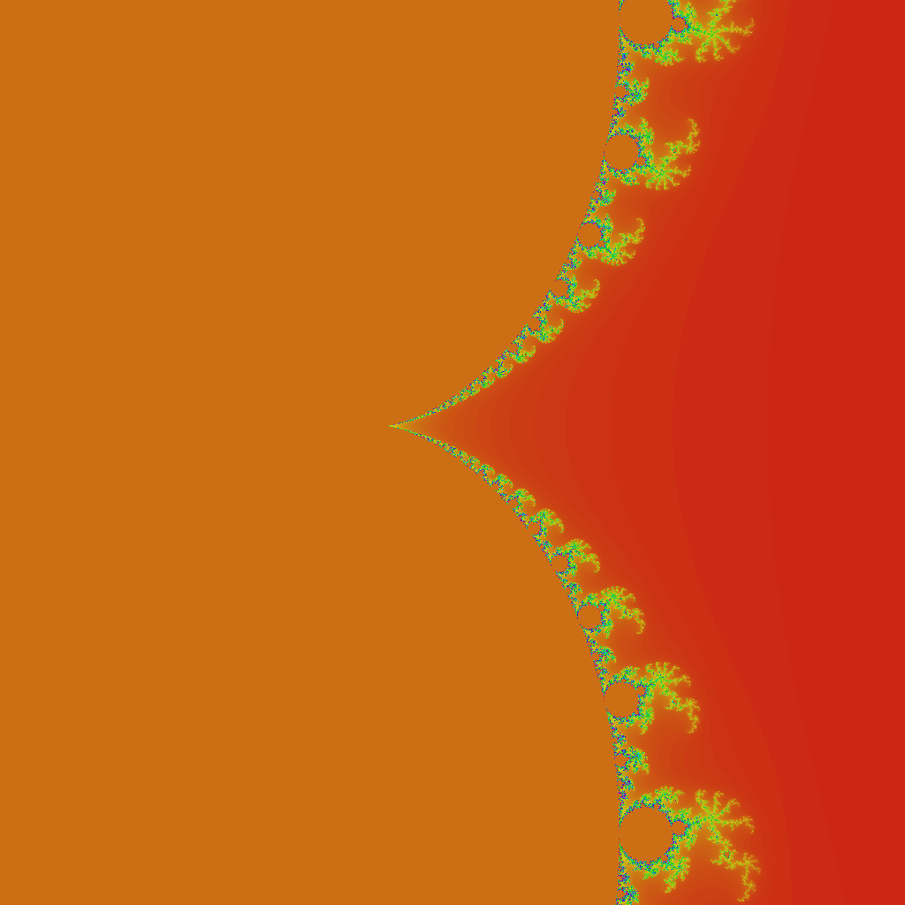

# Mandelbrot Set


> 망델브로 집합 이미지를 MPI로 나눠서 그리는 프로젝트

  

## 배경

2024 UNIST 슈퍼컴퓨팅 프로젝트 과제입니다.

망델브로 집합은 픽셀마다 반복 계산을 하는데, 집합 안쪽 픽셀은 최대 횟수까지 돌고 바깥쪽은 금방 끝납니다. 그래서 이미지를 프로세스 수만큼 같은 높이로 자르면 일부 프로세스만 오래 걸립니다. 이걸 줄이려고 행을 나누는 방식을 바꿔봤습니다.

## 주요 기능

- `mandel_mpi.py`: 행을 프로세스 수만큼 똑같이 나누는 기본 버전
- `mandel_mpi_U.py`: 행을 홀수 등차수열(2s−1, 2s−3, …, 1) 비율로 나누는 버전. 비율의 합이 s²이라 전체 행 수가 딱 맞게 나뉩니다
- `video.py`: 만든 이미지들을 영상으로 합치기

## 설치

```bash
pip install numpy mpi4py pillow opencv-python
```

## 사용법

```bash
mpirun -n 4 python src/mandel_mpi_U.py -x -0.38 -y -0.665 -s 0.05 -W 1024 -H 1024 -m 1000 -o out.png
```

`-x -y`: 중심 좌표 / `-s`: 확대 범위 / `-W -H`: 이미지 크기 / `-m`: 최대 반복 횟수 / `-o`: 출력 파일

## 라이선스

[GPL-3.0](LICENSE)
